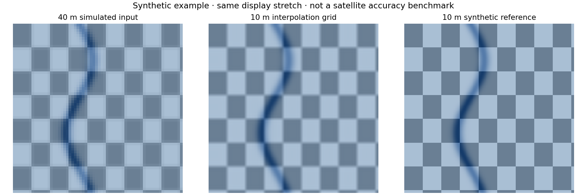

# Machine Learning Based Geospatial Super Resolution System

**Geo Enhance** is the local interface included with this project. Contributions are welcome;
start with [CONTRIBUTING.md](CONTRIBUTING.md).

A trainable 2×/4×/8× reconstruction pipeline for **continuous optical GeoTIFF imagery**. A 40 m input processed at 4× produces a 10 m grid with the same geographic extent. Output spacing is not proof of effective resolution: learned details are estimates. No trained weights or satellite dataset are bundled.



This illustration uses artificial data and interpolation, not a trained satellite
model. Reproduce it with `python examples/preview_baseline.py`.

## What is implemented

- Residual CNN with pixel-shuffle upsampling, bicubic skip, arbitrary band count, and no batch normalization. Defaults: 64 features and 8 residual blocks.
- Training with randomized optical blur, area integration, modest noise, rotations and flips; Charbonnier reconstruction and spatial-gradient losses. These are an approximate degradation model, not calibrated sensor physics.
- Geographically separate train/validation scenes; overlapping bounding footprints are rejected before patch generation.
- Best-validation checkpoint, fixed validation degradation, gradient clipping, seeded training, and a bicubic comparison every epoch.
- Evaluation: MAE, RMSE, PSNR, SSIM and multispectral spectral angle. Metrics use the configured normalized range, never a per-image contrast stretch.
- Windowed inference with context halos, optional eight-orientation averaging, float32 GeoTIFF output, preserved CRS/extent/band descriptions/scales/offsets, and conservative shared validity across all bands.
- Interpolation methods work without PyTorch. They are explicitly labeled baselines.
- Aligned LR/HR-pair training, strict grid/radiometry checks, early stopping, and checkpoint metadata validation.
- Independent-reference GeoTIFF evaluation with pixel-weighted per-band errors, bias, PSNR and spectral angle.
- Processing reports, checkpoint fingerprints, tile progress, selectable preview bands, and optional GIS overviews.

**Status:** a tested local research tool, not a validated production satellite model. See the [model card](docs/MODEL_CARD.md) for intended use and limitations, and [contributing guide](CONTRIBUTING.md) for development.

## Setup (PowerShell)

```powershell
python -m venv .venv
.\.venv\Scripts\python.exe -m pip install -r requirements.txt
.\.venv\Scripts\python.exe main.py --help
```

For GPU training, install the PyTorch build appropriate to your CUDA hardware using the [official installation selector](https://pytorch.org/get-started/locally/). CPU operation is supported. Windows DLL load errors are environment problems; verify `python -c "import torch"` before training.

For a lighter installation without model training, install `requirements-core.txt`. Supported Python versions are 3.10–3.11. Linux/macOS users can use `.venv/bin/python` in place of the Windows interpreter paths below. Dependency ranges are constrained; they are not an exact environment lock.

## Start with an interpolation baseline

```powershell
.\.venv\Scripts\python.exe main.py inspect data/input_40m.tif
.\.venv\Scripts\python.exe main.py predict data/input_40m.tif outputs/bicubic_10m.tif --method bicubic --scale 4
```

Scale refers to each pixel axis. An 8× run from 40 m creates a 5 m grid, 64 times as many pixels, and substantially greater uncertainty. A trained model supports only its checkpoint's scale. Projected meter-based rasters report meters; geographic CRS rasters remain in degrees. The tool does not silently reproject them or label degrees as meters.

## Train a model

Place cloud-masked high-resolution optical scenes in `data/hr/train` and geographically separate scenes in `data/hr/val`. Use matching sensor/product, native resolution, stored-value units, bands and band order. Export cloud/shadow masks into raster validity masks or NoData first; clouds are not detected automatically. Prefer independent regions and dates, and keep a third independent test set for final scientific claims.

```powershell
.\.venv\Scripts\python.exe main.py prepare --train-dir data/hr/train --val-dir data/hr/val --output data/prepared --scale 4 --patch-size 128 --value-scale 10000
.\.venv\Scripts\python.exe main.py train --data data/prepared --output models/run01 --epochs 50 --batch-size 8 --device auto
.\.venv\Scripts\python.exe main.py evaluate --data data/prepared --checkpoint models/run01/best.pt --report outputs/evaluation.json
.\.venv\Scripts\python.exe main.py predict data/input_40m.tif outputs/model_10m.tif --checkpoint models/run01/best.pt --scale 4 --ensemble
```

Normalization is `(stored_value - value_offset) / value_scale`. The default 10000 is appropriate only for products whose stored values use that scaling. For already-normalized reflectance, use `--value-scale 1`. Product-specific additive offsets must be handled explicitly with `--value-offset` or preprocessed consistently. GeoTIFF scale/offset metadata is preserved but not automatically applied to training values. Match inference inputs to the training convention. Values are not clipped, preserving valid scientific ranges.

High-resolution 10 m training scenes at scale 4 produce simulated 40 m observations. Training patches containing any invalid pixels are skipped. Training/validation files must not overlap geographically; the conservative WGS84 bounding-box check can also reject rotated or dateline-crossing scenes with overlapping bounding boxes. Use clean regional subsets in those cases. `--max-patches` caps each split; sampling proceeds in sorted scene/raster order, so ensure geographic representation in your input selection.

The best checkpoint is selected using validation MAE. Read `beats_bicubic` before trusting it; a saved checkpoint can still perform worse than the baseline. `--patience 10` stops training after ten epochs without a lower validation MAE; use `--patience 0` to disable this. Synthetic validation does **not** establish performance on real 40 m imagery. For that, collect co-registered reference observations, model the actual sensor blur/noise, and evaluate independent scenes and downstream tasks. Multitemporal fusion is not implemented.

### Training with observed LR/HR pairs

Provide geographically separated HR train/validation directories and corresponding LR directories. Each split must have exactly matching unique GeoTIFF filenames. HR/LR pairs must have the same CRS, band descriptions, scale/offset metadata and extent, with exactly the specified dimension/transform ratio. No silent warping is performed. Patch stride must be divisible by scale. Both resolutions must be valid for a patch to be kept.

```powershell
.\.venv\Scripts\python.exe main.py prepare --train-dir data/hr/train --val-dir data/hr/val --lr-train-dir data/lr/train --lr-val-dir data/lr/val --output data/paired --scale 4 --patch-size 128 --stride 128 --value-scale 1
.\.venv\Scripts\python.exe main.py train --data data/paired --output models/paired-run --epochs 100 --patience 10
```

Paired inputs are used directly, with synchronized rotations/flips rather than synthetic degradation. Matching grids do not guarantee correct acquisition timing, sensor spectral response, cloud masking or co-registration; verify these before training. New checkpoints enforce the training band descriptions and radiometric metadata during inference. Older checkpoints remain readable but lack these checks.

### Validate an output against a reference

```powershell
.\.venv\Scripts\python.exe main.py compare outputs/model_10m.tif data/reference_10m.tif --data-range 1 --report outputs/reference-evaluation.json
```

Use a truly independent, co-registered reference with the same grid, CRS and bands. The command rejects alignment differences (absolute transform tolerance 1e-8 CRS units) instead of silently resampling. It streams float64 metric accumulation across joint valid pixels, so tile size does not change the metrics. Reports include overall/per-band MAE, RMSE, signed bias, PSNR, valid coverage and spectral angle. Set `--data-range` to the meaningful signal range in stored units; use `--apply-scale-offset` to compare physical values. Exact matches have `psnr_db: null` and `exact_match: true` to represent infinity in valid JSON. SSIM is intentionally omitted from masked full-raster comparisons; patch evaluation still includes it. Report paths are exclusive and never overwrite existing files.

## Interface

**Windows: double-click `Start GUI.cmd` in the project folder.** It starts Geo Enhance without the optional email prompt and opens your browser at http://127.0.0.1:8501 after the server is ready. Keep its terminal window open while using the app; press Ctrl+C there to stop it. If the browser does not open automatically, visit that address yourself. If port 8501 is occupied, stop your previous instance or use `python launch_gui.py --port 8502`. The launcher does not terminate other applications.

1. Drag a `.tif` or `.tiff` into **Upload GeoTIFF**, choose **Local file path**, or select **Try the demo**.
2. Select **4×** for a 40 m → 10 m grid. The app reads the actual spacing from the file and shows the planned output.
3. Keep **Smooth resize** for immediate use. **Trained model** requires a trained checkpoint that matches your bands and scale.
4. Click **Create enhanced GeoTIFF**, compare the previews, and click **Download enhanced GeoTIFF**.

Uploads are limited to 200 MB. Use a local path for larger images or GeoTIFFs with external mask/metadata files. Results are saved under `outputs/gui/<session>/`; files up to 128 MB also have an in-browser download button. These files persist on disk, so remove unwanted sessions when you no longer need them. The browser download does not delete the saved output. Each generation creates a new file, and the last result stays visible when settings change.

To start manually from the project directory:

```powershell
.\.venv\Scripts\python.exe launch_gui.py
```

The app is bound to this computer's loopback address. Both previews use the input image's contrast stretch. Select preview RGB bands in **Preview band colors**; all bands remain in the exported raster. Advanced settings expose tile size, CPU/GPU selection, orientation averaging and GIS overviews. Results include a downloadable processing report; an additional panel compares the output against a local reference GeoTIFF. The demo also works in a fresh clone without downloaded data.

Each GUI output has a JSON sidecar with its grid and processing provenance. GeoTIFF tags also record method, source basename, UTC creation time, normalization and checkpoint SHA-256 when applicable. Reports omit absolute input paths; source basenames and geospatial coordinates can still be sensitive. Output reservation `.lock` files prevent simultaneous application jobs from choosing the same destination. A crash may leave a lock/temporary file: confirm that no job is using it before removing it. Python-level failures clean up their own partial outputs and locks.

## Reproduce the synthetic demonstration

The demonstration workflow creates artificial patterns, a small test checkpoint, and comparison outputs. **Do not use those weights as a satellite model.** The following commands reproduce the run in a fresh checkout (choose fresh directories if these outputs already exist):

```powershell
.\.venv\Scripts\python.exe examples/make_demo.py --output data/demo
.\.venv\Scripts\python.exe main.py prepare --train-dir data/demo/train --val-dir data/demo/val --output data/demo-prepared --scale 4 --patch-size 128 --stride 64 --value-scale 1
.\.venv\Scripts\python.exe main.py train --data data/demo-prepared --output models/synthetic-demo --epochs 20 --batch-size 3 --features 32 --blocks 4 --device auto
.\.venv\Scripts\python.exe main.py evaluate --data data/demo-prepared --checkpoint models/synthetic-demo/best.pt --report outputs/demo/evaluation.json
.\.venv\Scripts\python.exe main.py predict data/demo/synthetic_40m.tif outputs/demo/model_10m.tif --checkpoint models/synthetic-demo/best.pt --scale 4 --ensemble
.\.venv\Scripts\python.exe main.py predict data/demo/synthetic_40m.tif outputs/demo/bicubic_10m.tif --method bicubic --scale 4
.\.venv\Scripts\python.exe examples/compare_demo.py
```

A 20-epoch synthetic demonstration produced validation MAE 0.013295 versus bicubic 0.013348, and SSIM 0.88612 versus 0.88515: a small improvement that verifies learning, not a claim of useful real-world enhancement. Evaluation averages nine overlapping patches from one held-out synthetic scene; these are not nine independent geographic samples. The evaluation uses ordinary model inference; the exported demo raster uses orientation averaging. The two outputs are therefore not identical evaluation configurations.

The recorded demonstration used PyTorch 2.13.0+cu126 and Rasterio 1.4.4. Its saved artifacts are not distributed by Git. Current raster bicubic export uses the same Keys kernel as the training baseline, so the older saved raster comparison may differ from a new run.

## Validation

```powershell
.\.venv\Scripts\python.exe -m unittest discover -s tests -v
```

Tests generate small temporary georeferenced fixtures and exercise the GUI, training/inference, real-pair preparation, reference metrics, radiometric scaling, interpolation equivalence, locks, cleanup, and launcher lifecycle. They do not claim satellite reconstruction quality. A GitHub Actions workflow is included for Windows/Linux with CPU PyTorch; it runs after the repository is uploaded. Local test results do not establish that an unexecuted CI job has passed.

## Practical limits

This version targets optical continuous-valued imagery and processes values in float32. DEMs, thermal imagery, categorical labels and SAR need domain-specific objectives and validation. Palette/alpha bands are rejected; preserve alpha as a validity mask when preparing continuous bands. Invalid input pixels remain invalid; nearby missing values are filled from the nearest valid sample only to provide computational context, so predictions near missing regions are less reliable. Bicubic export uses a NumPy Keys implementation tested against PyTorch's half-pixel interpolation convention. Output is a tiled compressed GeoTIFF with optional average overviews, not a certified cloud-optimized GeoTIFF. Memory use grows with tile size, bands, scale and model width; reduce `--tile-size` or training batch size when needed. No claim of 5 m or 10 m effective resolution should be made without independent reference measurements.

## Sharing on GitHub

Source code is MIT licensed. Imagery and trained model distribution rights must be checked separately. `.gitignore` excludes datasets, GUI uploads, outputs, checkpoints, secrets, logs and virtual environments. Inspect the staged file list before publishing; ignore rules do not untrack already committed files. No repository is created or published automatically by this project. See [CONTRIBUTING.md](CONTRIBUTING.md) for setup and issue-reporting guidance.

The repository includes bug/feature forms, a pull request template, community
guidelines and dependency-update configuration. Contributors can fork it and
submit pull requests; maintainers decide which changes to merge. Follow the
[maintainer checklist](docs/MAINTAINER_CHECKLIST.md) after publishing to enable
repository settings that cannot be configured through source files alone.

See [release verification](docs/RELEASE_VERIFICATION.md) for tested workflows and
remaining limits. To build a clean source folder and ZIP, run
`python scripts/package_release.py --output ../new-release-folder` with a new
destination name. Existing releases are never overwritten.

References: [Rasterio resampling](https://rasterio.readthedocs.io/en/stable/topics/resampling.html), [windowed processing](https://rasterio.readthedocs.io/en/stable/topics/windowed-rw.html), [PyTorch checkpoint loading](https://docs.pytorch.org/docs/stable/generated/torch.load.html).
