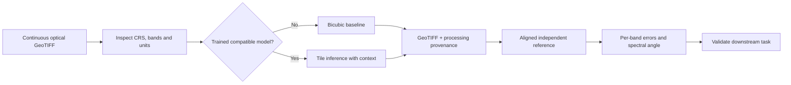

# A defensible workflow

For training, prefer aligned observations from compatible sensors/products.
When those are unavailable, simulated low-resolution inputs provide a useful
experiment, but the synthetic-to-real gap must be measured separately. Separate
geographic regions before extracting patches. Keep a third untouched region for
final evaluation; validation has already influenced checkpoint selection.

When an output fails to outperform interpolation, retain the baseline. When a
comparison fails grid checks, fix co-registration in GIS preprocessing rather than
resampling silently inside the evaluator. Report signal range, units, acquisition
conditions, valid coverage and all inference settings with accuracy numbers.

The software exports estimates at a finer sample spacing. Establishing real
spatial resolving power requires independent observations and task-specific tests.
